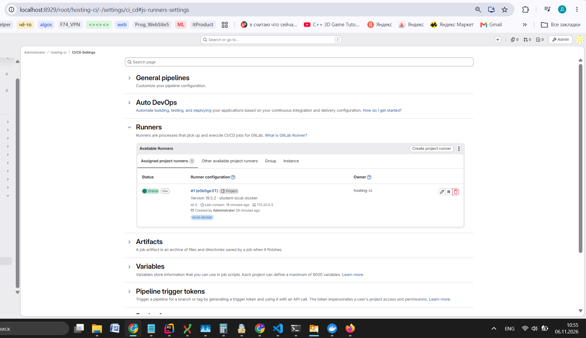
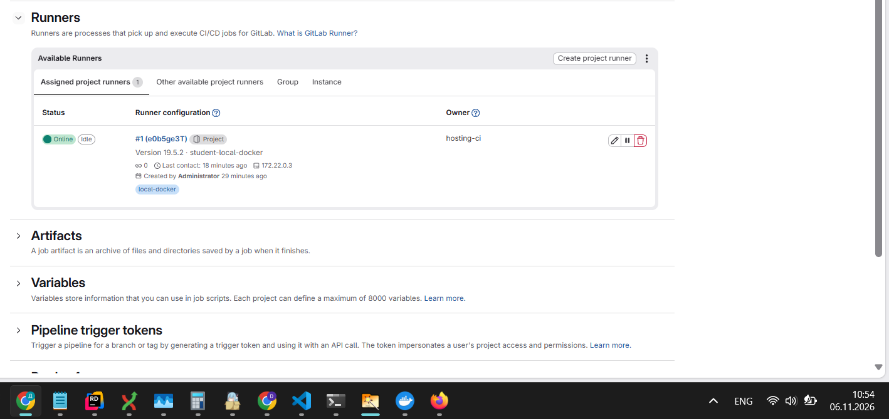

# ДЗ 1. Своё приложение в Kubernetes

## 1. Данные автора

- ФИО: **Мостовов Дмитрий Сергеевич**
- Группа: **ФТ-303**
- ОС: Windows 11 с WSL2
- Архитектура: `amd64`

## REPORT
# 1
### PS C:\Users\HOMELite> docker version
Client:
 Version:           27.4.0
 API version:       1.47
 Go version:        go1.22.10
 Git commit:        bde2b89
 Built:             Sat Dec  7 10:40:21 2024
 OS/Arch:           windows/amd64
 Context:           desktop-linux

Server: Docker Desktop 4.37.1 (178610)
 Engine:
  Version:          27.4.0
  API version:      1.47 (minimum version 1.24)
  Go version:       go1.22.10
  Git commit:       92a8393
  Built:            Sat Dec  7 10:38:57 2024
  OS/Arch:          linux/amd64
  Experimental:     false
 containerd:
  Version:          1.7.21
  GitCommit:        472731909fa34bd7bc9c087e4c27943f9835f111
 runc:
  Version:          1.1.13
  GitCommit:        v1.1.13-0-g58aa920
 docker-init:
  Version:          0.19.0
  GitCommit:        de40ad0


   ### docker info
Client:
 Version:    27.4.0
 Context:    default
 Debug Mode: false
 Plugins:
  ai: Ask Gordon - Docker Agent (Docker Inc.)
    Version:  v0.5.1
    Path:     /usr/local/lib/docker/cli-plugins/docker-ai
  buildx: Docker Buildx (Docker Inc.)
    Version:  v0.19.2-desktop.1
    Path:     /usr/local/lib/docker/cli-plugins/docker-buildx
  compose: Docker Compose (Docker Inc.)
    Version:  v2.31.0-desktop.2
    Path:     /usr/local/lib/docker/cli-plugins/docker-compose
  debug: Get a shell into any image or container (Docker Inc.)
    Version:  0.0.37
    Path:     /usr/local/lib/docker/cli-plugins/docker-debug
  desktop: Docker Desktop commands (Beta) (Docker Inc.)
    Version:  v0.1.0
    Path:     /usr/local/lib/docker/cli-plugins/docker-desktop
  dev: Docker Dev Environments (Docker Inc.)
    Version:  v0.1.2
    Path:     /usr/local/lib/docker/cli-plugins/docker-dev
  extension: Manages Docker extensions (Docker Inc.)
    Version:  v0.2.27
    Path:     /usr/local/lib/docker/cli-plugins/docker-extension
  feedback: Provide feedback, right in your terminal! (Docker Inc.)
    Version:  v1.0.5
    Path:     /usr/local/lib/docker/cli-plugins/docker-feedback
  init: Creates Docker-related starter files for your project (Docker Inc.)
    Version:  v1.4.0
    Path:     /usr/local/lib/docker/cli-plugins/docker-init
  sbom: View the packaged-based Software Bill Of Materials (SBOM) for an image (Anchore Inc.)
    Version:  0.6.0
    Path:     /usr/local/lib/docker/cli-plugins/docker-sbom
  scout: Docker Scout (Docker Inc.)
    Version:  v1.15.1
    Path:     /usr/local/lib/docker/cli-plugins/docker-scout

Server:
 Containers: 26
  Running: 15
  Paused: 0
  Stopped: 11
 Images: 77
 Server Version: 27.4.0
 Storage Driver: overlay2
  Backing Filesystem: extfs
  Supports d_type: true
  Using metacopy: false
  Native Overlay Diff: true
  userxattr: false
 Logging Driver: json-file
 Cgroup Driver: cgroupfs
 Cgroup Version: 1
 Plugins:
  Volume: local
  Network: bridge host ipvlan macvlan null overlay
  Log: awslogs fluentd gcplogs gelf journald json-file local splunk syslog
 CDI spec directories:
  /etc/cdi
  /var/run/cdi
 Swarm: inactive
 Runtimes: io.containerd.runc.v2 nvidia runc
 Default Runtime: runc
 Init Binary: docker-init
 containerd version: 472731909fa34bd7bc9c087e4c27943f9835f111
 runc version: v1.1.13-0-g58aa920
 init version: de40ad0
 Security Options:
  seccomp
   Profile: unconfined
 Kernel Version: 5.15.167.4-microsoft-standard-WSL2
 Operating System: Docker Desktop
 OSType: linux
 Architecture: x86_64
 CPUs: 8
 Total Memory: 3.828GiB
 Name: docker-desktop
 ID: f4367e72-f458-43ff-9b26-6b08717770c8
 Docker Root Dir: /var/lib/docker
 Debug Mode: false
 HTTP Proxy: http.docker.internal:3128
 HTTPS Proxy: http.docker.internal:3128
 No Proxy: hubproxy.docker.internal
 Labels:
  com.docker.desktop.address=unix:///var/run/docker-cli.sock
 Experimental: false
 Insecure Registries:
  hubproxy.docker.internal:5555
  127.0.0.0/8
 Live Restore Enabled: false

WARNING: No blkio throttle.read_bps_device support
WARNING: No blkio throttle.write_bps_device support
WARNING: No blkio throttle.read_iops_device support
WARNING: No blkio throttle.write_iops_device support
WARNING: daemon is not using the default seccomp profile

### kind version
kind v0.27.0 go1.23.6 linux/amd64

###  kubectl version --client
Client Version: v1.37.1
Kustomize Version: v5.8.1

###  git --version
git version 2.43.0


### kind get clusters
### docker ps -a --format 'table {{.Names}}\t{{.Status}}\t{{.Ports}}'
hosting-lab
NAMES                                                                                      STATUS                          PORTS
tasktracker-grafana-1                                                                      Exited (255) 42 minutes ago     0.0.0.0:3000->3000/tcp
tasktracker-worker-1                                                                       Exited (255) 42 minutes ago     8080/tcp
tasktracker-notifications-1                                                                Exited (255) 42 minutes ago     0.0.0.0:8081->8080/tcp
tasktracker-api-1                                                                          Exited (255) 42 minutes ago     0.0.0.0:8080->8080/tcp
tasktracker-prometheus-1                                                                   Exited (255) 42 minutes ago     0.0.0.0:9090->9090/tcp
tasktracker-postgres-1                                                                     Exited (0) About a minute ago
tasktracker-rabbitmq-1                                                                     Exited (0) About a minute ago
tasktracker-jaeger-1                                                                       Exited (255) 42 minutes ago     4318/tcp, 5778-5779/tcp, 9411/tcp, 13132-13133/tcp, 14250/tcp, 0.0.0.0:4317->4317/tcp, 0.0.0.0:16686->16686/tcp, 14268/tcp
cc_tasktracker_ba4784-claude-code-1                                                        Exited (255) 42 minutes ago     0.0.0.0:1455->1455/tcp, 0.0.0.0:55320->55320/tcp
cc_f74_c485c2-claude-code-1                                                                Exited (255) 2 days ago         0.0.0.0:1455->1455/tcp, 0.0.0.0:55320->55320/tcp
cc_homelite_72cf63-claude-code-1                                                           Created                      
cc_2c96dca07abf9b80a135d8312ae773778d000875d847164870004528acb9a964_b4dac1-claude-code-1   Exited (137) 5 days ago      
hosting-lab-control-plane                                                                  Up 41 minutes                   127.0.0.1:39535->6443/tcp
cc_e80d625ccbe1835525cc5edd41c8b3ad0fd87bcd60251906c709528a37a026fa_61fa24-claude-code-1   Exited (137) 13 days ago     
mongodb                                                                                    Exited (137) 2 weeks ago     
hosting-lab-registry                                                                       Up 41 minutes                   127.0.0.1:5001->5000/tcp
first-app-1                                                                                Exited (0) 3 weeks ago       
first-nginx-1                                                                              Exited (0) 3 weeks ago       
first-db-1                                                                                 Exited (0) 3 weeks ago       
first-cache-1                                                                              Exited (0) 3 weeks ago       
llm-agent-f-langfuse-web-1                                                                 Up 4 seconds                    0.0.0.0:3000->3000/tcp
llm-agent-f-langfuse-worker-1                                                              Up 41 minutes                   127.0.0.1:3030->3030/tcp
llm-agent-f-clickhouse-1                                                                   Up 41 minutes (healthy)         127.0.0.1:8123->8123/tcp, 127.0.0.1:9000->9000/tcp, 9009/tcp
llm-agent-f-redis-1                                                                        Up 41 minutes (healthy)         127.0.0.1:6379->6379/tcp
llm-agent-f-minio-1                                                                        Up 41 minutes (healthy)         0.0.0.0:9090->9000/tcp, 127.0.0.1:9091->9001/tcp
llm-agent-f-postgres-1                                                                     Exited (128) 2 days ago      

### kubectl --context kind-hosting-lab get nodes -o wide
NAME                        STATUS   ROLES           AGE   VERSION   INTERNAL-IP   EXTERNAL-IP   OS-IMAGE                         KERNEL-VERSION                       CONTAINER-RUNTIME
hosting-lab-control-plane   Ready    control-plane   13d   v1.32.2   172.21.0.2    <none>        Debian GNU/Linux 12 (bookworm)   5.15.167.4-microsoft-standard-WSL2   containerd://2.0.2

# 2

# 59b04643$ docker ps -a --format 'table {{.Names}}\t{{.Status}}\t{{.Ports}}'
``` bash
dima@DESKTOP-A65H6VF:/mnt/d/Dima/3University/DevOps/hw2/first$ docker ps --format 'table {{.Names}}\t{{.Status}}\t{{.Ports}}'
NAMES                       STATUS                  PORTS
fiit-runner                 Up 26 minutes
fiit-gitlab                 Up 12 hours (healthy)   22/tcp, 80/tcp, 443/tcp, 127.0.0.1:8929->8929/tcp
hosting-lab-control-plane   Up 12 hours             127.0.0.1:39535->6443/tcp
hosting-lab-registry        Up 12 hours             127.0.0.1:5001->5000/tcp
```

# 3
скачивал docker pull gitlab/gitlab-ce:latest


```bash
dima@DESKTOP-A65H6VF:  docker tag gitlab/gitlab-ce:latest fiit/gitlab:lab
dima@DESKTOP-A65H6VF:  docker tag gitlab/gitlab-runner:latest fiit/runner:lab
dima@DESKTOP-A65H6VF:  docker tag docker:cli fiit/docker-cli:lab
dima@DESKTOP-A65H6VF:  docker image inspect fiit/gitlab:lab fiit/runner:lab fiit/docker-cli:lab \
  --format '{{.RepoTags}} {{.Os}}/{{.Architecture}} {{.Id}}'
[fiit/gitlab:lab gitlab/gitlab-ce:latest] linux/amd64 sha256:f88c118808549ed0d65d94342db6eb5b11b53ba8692e6a4b8c87ef1a48687e41
[fiit/runner:lab gitlab/gitlab-runner:latest] linux/amd64 sha256:0f14d887fd920881d146fc7d3301c4da8408455be14e8560933314875e116746
[fiit/docker-cli:lab docker:cli] linux/amd64 sha256:40cf18b07f7255f0f57566052a842b83959381e53a15e888b0dc621362a57c38
```
# 4
``` bash
dima@DESKTOP-A65H6VF:/mnt/d/Dima/3University/DevOps/hw2/first$ curl http://localhost:8929/-/readiness
{"error":"Not Found","status":404}
dima@DESKTOP-A65H6VF:/mnt/d/Dima/3University/DevOps/hw2/first$ curl http://localhost:8929/-/health
Not Found
dima@DESKTOP-A65H6VF:/mnt/d/Dima/3University/DevOps/hw2/first$ curl http://localhost:8929/-/liveness
{"error":"Not Found","status":404}
```

Но в браузере грузится


# 5


docker exec fiit-runner gitlab-runner verify
Runtime platform                                    arch=amd64 os=linux pid=22 revision=66ad5002 version=19.5.2
Running in system-mode.

Verifying runner... is valid                        correlation_id=01M6QNEC1NEQNVV140FK5A289C runner=e0b5ge3Tf runner_name=student-local-docker


# 6

```bash
docker run --rm \
  --network gitlab-lab \
  --volume /var/run/docker.sock:/var/run/docker.sock \
  fiit/docker-cli:lab sh -ec '
    docker version
    docker ps --format "table {{.Names}}\t{{.Status}}"
    wget -qO- http://gitlab:8929/-/readiness
  '
Client:
 Version:           29.9.3
 API version:       1.47 (downgraded from 1.56)
 Go version:        go1.26.10
 Git commit:        5457199
 Built:             Tue Nov  3 21:42:08 2026
 OS/Arch:           linux/amd64
 Context:           default

Server: Docker Desktop 4.0.0 ()
 Engine:
  Version:          27.4.0
  API version:      1.47 (minimum version 1.24)
  Go version:       go1.22.10
  Git commit:       92a8393
  Built:            Sat Dec  7 10:38:57 2024
  OS/Arch:          linux/amd64
  Experimental:     false
 containerd:
  Version:          1.7.21
  GitCommit:        472731909fa34bd7bc9c087e4c27943f9835f111
 runc:
  Version:          1.1.13
  GitCommit:        v1.1.13-0-g58aa920
 docker-init:
  Version:          0.19.0
  GitCommit:        de40ad0
NAMES                       STATUS
hopeful_moore               Up 1 second
fiit-runner                 Up 12 minutes
fiit-gitlab                 Up 11 hours (healthy)
hosting-lab-control-plane   Up 11 hours
hosting-lab-registry        Up 11 hours
wget: server returned error: HTTP/1.1 404 Not Found
```

# 7
```bash
 FIIT_KUBE_VERSION="v1.37.1"

docker pull "registry.k8s.io/kubectl:$FIIT_KUBE_VERSION"

docker run --rm -i \
  --network gitlab-lab \
  "registry.k8s.io/kubectl:$FIIT_KUBE_VERSION" \
  --kubeconfig /dev/stdin get nodes \
  < "$HOME/.config/fiit-gitlab/kubeconfig"
v1.37.1: Pulling from kubectl
a5789fc40e82: Pull complete
990a9c434e5e: Pull complete
39dc083afc39: Pull complete
bf7a4185f015: Pull complete
2780920e5dbf: Pull complete
7c12895b777b: Pull complete
3214acf345c0: Pull complete
52630fc75a18: Pull complete
dd64bf2dd177: Pull complete
b839dfae01f6: Pull complete
dcaa5a89b0cc: Pull complete
96ed2737ae31: Pull complete
6e10fc9c4a45: Pull complete
131808c81673: Pull complete
Digest: sha256:b7cab618e281b1ee7484e7b706a96e2135fbb6e072c2a573a7dab4e87d7f2385
Status: Downloaded newer image for registry.k8s.io/kubectl:v1.37.1
registry.k8s.io/kubectl:v1.37.1
NAME                        STATUS   ROLES           AGE   VERSION
hosting-lab-control-plane   Ready    control-plane   13d   v1.32.2


dima@DESKTOP-A65H6VF:/mnt/d/Dima/3University/DevOps/hw2/first$  kubectl --context kind-hosting-lab get nodes -o wide
NAME                        STATUS   ROLES           AGE   VERSION   INTERNAL-IP   EXTERNAL-IP   OS-IMAGE                         KERNEL-VERSION                       CONTAINER-RUNTIME
hosting-lab-control-plane   Ready    control-plane   13d   v1.32.2   172.21.0.2    <none>        Debian GNU/Linux 12 (bookworm)   5.15.167.4-microsoft-standard-WSL2   containerd://2.0.2
```

