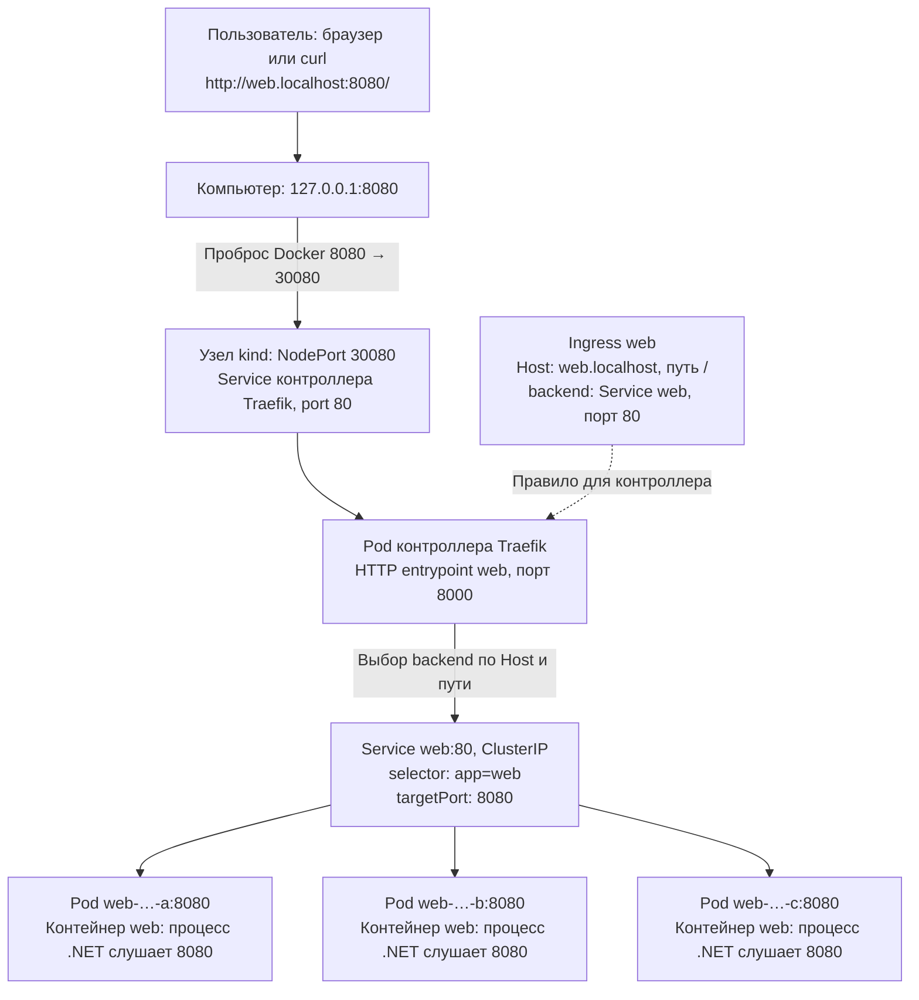
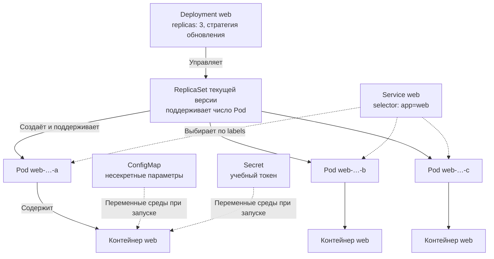

# Практическое занятие 2

## 1. Service: единый адрес для реплик приложения

### 1.1. Подготовим три реплики

Исходная точка — результат пунктов 1–3 первого занятия: kind, namespace `hosting-lab`, рабочие `deployment.yaml`, `configmap.yaml` и `secret.yaml`. Service и приложение client на первом занятии не создавали; их наличие не предполагается.

Продолжаем на локальном kind первого занятия. Команды выполняем из отдельного рабочего каталога с нашими YAML; сборку приложения выполняем из каталога, куда клонирован репозиторий `probes-app`. В Windows используем Ubuntu WSL2. Выберем контекст и namespace:

```bash
kubectl config use-context kind-hosting-lab
kubectl config set-context kind-hosting-lab --namespace=hosting-lab
```

Чтобы различать ответы реплик, на втором занятии заменим приложение первого занятия подготовленным примером .NET, который на GET `/` возвращает имя Pod. Исходники и Dockerfile получаем из https://gitflic.ru/project/fiit-devops/probes-app.git; это новый пример, а не результат первого занятия. В дальнейшем он также понадобится для проб. Клонируем репозиторий в каталог рядом с рабочими YAML и соберём образ:

```bash
git clone https://gitflic.ru/project/fiit-devops/probes-app.git
docker build -t localhost:5001/probes-web:v2 ./probes-app
docker push localhost:5001/probes-web:v2
```

В рабочем `deployment.yaml` первого занятия установим `spec.replicas: 3`, заменим образ контейнера `web` и добавим именованный порт:

```yaml
          image: localhost:5001/probes-web:v2
          ports:
            - name: http
              containerPort: 8080
```

Сохраняем labels `app: web`, selector, ConfigMap и Secret из первого занятия. Пробы пока не добавляем. Приложение возвращает hostname контейнера, который в нашем стандартном Pod соответствует его имени; отдельная настройка `POD_NAME` для этого эксперимента не обязательна.

```bash
kubectl apply -f deployment.yaml
kubectl rollout status deployment/web --timeout=180s
kubectl get pods -l app=web -o wide
```

Ожидаем три работающие реплики. Если остался отдельный Pod с меткой `app: web` из предыдущих опытов, удалим только этот отдельный Pod: иначе он тоже попадёт под selector будущего Service.

### 1.2. Port-forward Deployment выбирает один Pod

В первом терминале:

```bash
kubectl port-forward deployment/web 8081:8080
```

Во втором выполним несколько отдельных запросов:

```bash
for i in $(seq 1 12); do
  curl --max-time 3 -fsS http://localhost:8081/
  echo
done
```

Увидим одно и то же имя Pod. При запуске port-forward kubectl выбирает одну реплику и держит туннель к ней. Новое соединение curl не заставляет kubectl выбирать другую реплику. При удалении выбранного Pod потребуется заново запустить port-forward.

### 1.3. Создадим Service

IP и имена отдельных Pod меняются при пересоздании. Service даёт приложению постоянное DNS-имя и виртуальный IP, а selector связывает его с нужными Pod. Обычный Service типа `ClusterIP` доступен внутри кластера; сам по себе он не публикует приложение на компьютере студента или в интернете.

Создадим в рабочем каталоге `service.yaml`:

```yaml
apiVersion: v1
kind: Service
metadata:
  name: web
spec:
  selector:
    app: web
  ports:
    - port: 80
      targetPort: 8080
```

`ClusterIP` и TCP используются по умолчанию. `port: 80` — порт Service, `targetPort: 8080` — порт приложения в выбранных Pod. Selector выбирает Pod по меткам, а не по имени Deployment.

```bash
kubectl apply -f service.yaml
kubectl get service web
kubectl get endpointslices -l kubernetes.io/service-name=web -o wide
```

Сопоставим адреса EndpointSlice с IP трёх Pod из `kubectl get pods -o wide`. В том же namespace приложение доступно как `http://web/`, полное имя стандартного kind — `web.hosting-lab.svc.cluster.local`.

### 1.4. Curl к Service изнутри кластера

Обычный ClusterIP нельзя считать доступным напрямую с macOS/Windows. Поэтому запустим временный диагностический Pod с curl. Для этого нужен доступ к источнику образа; преподавателю стоит проверить его скачивание заранее.

```bash
kubectl run curl-client --image=curlimages/curl:8.12.1 --restart=Never --command -- sleep 3600
kubectl wait --for=condition=Ready pod/curl-client --timeout=180s
kubectl exec curl-client -- sh -c 'for i in $(seq 1 20); do curl --max-time 3 -fsS -H "Connection: close" http://web/; echo; sleep 1; done'
```

(Команда в одинарных кавычках выполняется оболочкой `sh` внутри Pod `curl-client`. `for i in $(seq 1 20)` повторяет действия 20 раз; `curl` отправляет GET-запрос к Service `web` на порт 80, а `--max-time 3` ограничивает время одного запроса тремя секундами. Флаги `-fsS`: считать HTTP-ответы с кодами 400 и выше ошибкой, скрыть индикатор прогресса, но показать сообщение об ошибке. Заголовок `Connection: close` просит закрыть соединение после ответа; каждый отдельный запуск curl и так создаёт новое соединение. `echo` добавляет перевод строки после ответа, `sleep 1` делает паузу в одну секунду перед следующей итерацией. Переменная `i` служит только счётчиком.)

Теперь запросы проходят по пути:

```text
curl-client → DNS web → ClusterIP Service:80 → одна из реплик web:8080
```

В выводе ожидаем разные имена Pod. Каждый отдельный запуск curl открывает новое соединение. В стандартном kind маршрутизация выбирает реплику для нового соединения; строгое чередование и равное число ответов от каждой реплики на короткой серии не гарантируются. Если все ответы одинаковые, проверим число готовых endpoints и совпадение labels.

**Важно:** `kubectl port-forward service/web 8083:80` не демонстрирует эту балансировку. Он тоже выбирает один Pod по Service и создаёт туннель прямо к нему, а не отправляет запросы через виртуальный IP Service. Поэтому здесь принципиален curl изнутри кластера.

После проверки удалим диагностический Pod:

```bash
kubectl delete pod curl-client
```

### 1.5. Обсудим результат

Контрольные вопросы: почему port-forward Deployment показывает одну реплику? Как Service находит Pod? Чем `port` отличается от `targetPort`? Что произойдёт с адресом Service после пересоздания одного Pod?

Документация: [Service](https://kubernetes.io/docs/concepts/services-networking/service/), [kubectl port-forward](https://kubernetes.io/docs/reference/kubectl/generated/kubectl_port-forward/).

## 2. Пробы и стратегии деплоя

### 2.1. Port-forward и ответы приложения без проб

Продолжаем с тем же `deployment.yaml` и образом, собранным в пункте 1. Повторная сборка и замена образа не нужны. ConfigMap и Secret первого занятия сохраняются. Пробы пока отсутствуют — их будем добавлять по одной в этом разделе.

Если после эксперимента с Service port-forward ещё работает, используем его; иначе запустим:

```bash
kubectl port-forward deployment/web 8081:8080
```

Port-forward открывает локальный порт 8081 и направляет его в порт 8080 одного выбранного Pod. Пока команда работает, во втором терминале выполняем:

```bash
curl -i http://localhost:8081/
curl -i http://localhost:8081/ready
curl -i http://localhost:8081/live
```

Обычный запрос `/` возвращает 200 и имя Pod (из `POD_NAME`, а если переменная не задана — hostname контейнера). Первые 10 секунд после запуска процесса `/ready` и `/live` возвращают 503, затем 200. Если к моменту подключения 10 секунд уже прошли, увидим сразу 200. Стартовую задержку гарантированно будем наблюдать по состоянию Pod на следующем шаге.

Вызовем учебный отказ:

```bash
curl -i http://localhost:8081/you-are-death
curl -i http://localhost:8081/live
curl -i http://localhost:8081/ready
curl -i http://localhost:8081/
kubectl get pods -l app=web
```

После `/you-are-death` путь `/live` возвращает 503 до перезапуска процесса. `/` продолжает отвечать, `/ready` после подготовки остаётся 200. Это управляемая имитация неисправности: процесс не завершился. Пока livenessProbe отсутствует, Kubernetes не знает о таком отказе и не перезапускает контейнер.

Port-forward не балансирует запросы между репликами и не проверяет маршрутизацию Service. Если выбранный Pod удалён или контейнер перезапущен, туннель может завершиться: остановим его через Ctrl+C и запустим заново.

### 2.2. Startup probe: дождаться запуска приложения

В тот же контейнер `web` добавим пробу на уровне `image`, `ports` и `env`:

```yaml
          startupProbe:
            httpGet:
              path: /live
              port: http
            periodSeconds: 2
            timeoutSeconds: 1
            failureThreshold: 30
```

Проверяем `/live` каждые 2 секунды, даём примерно 60 секунд на запуск. Для нашего приложения с 10-секундной подготовкой этого достаточно. При исчерпании порога неудач kubelet перезапустит контейнер; startupProbe не ждёт бесконечно.

Перед применением в отдельном терминале включим наблюдение:

```bash
kubectl get pods -l app=web -w
```

Теперь применим файл:

```bash
kubectl apply -f deployment.yaml
kubectl rollout status deployment/web --timeout=180s
```

Изменение шаблона создаст новый Pod с новым процессом и сбросит предыдущий учебный отказ. После запуска контейнера примерно 10 секунд видим `Running`, но `READY 0/1`, затем `1/1`. В `kubectl describe pod <имя-нового-Pod>` могут быть события неуспешных стартовых проверок с кодом 503. Это ожидаемый этап запуска, если затем проба стала успешной.

Startup probe выполняется до первого успеха при каждом запуске контейнера. После успеха она больше не проверяет его работоспособность. Если сейчас снова вызвать `/you-are-death`, одна startupProbe не обнаружит последующий отказ. Пока startupProbe не успешна, kubelet не выполняет liveness и readiness пробы.

### 2.3. Liveness probe: перезапустить неисправный контейнер

Сохраним startupProbe и рядом добавим:

```yaml
          livenessProbe:
            httpGet:
              path: /live
              port: http
            periodSeconds: 2
            timeoutSeconds: 1
            failureThreshold: 3
```

`initialDelaySeconds` здесь не нужен: начальную подготовку уже защищает startupProbe. Liveness начнёт работать после её успеха.

```bash
kubectl apply -f deployment.yaml
kubectl rollout status deployment/web --timeout=180s
```

Остановим старый port-forward, запустим новый и в другом терминале вызовем отказ:

```bash
kubectl port-forward deployment/web 8081:8080
```

```bash
curl -i http://localhost:8081/
curl -i http://localhost:8081/you-are-death
curl -i http://localhost:8081/live
kubectl get pods -l app=web -w
```

После трёх неудачных liveness-проверок kubelet начнёт перезапуск контейнера. Обычно отказ будет обнаружен примерно за 4–6 секунд; завершение и повторный запуск занимают дополнительное время. У того же Pod увеличится `RESTARTS`, имя Pod сохранится. Новый процесс снова проходит 10 секунд startup-проверок, затем становится готовым. Это отличается от замены Pod при обновлении Deployment: тогда меняется имя Pod.

Посмотрим причины и журнал предыдущего запуска:

```bash
kubectl describe pod <имя-Pod>
kubectl logs <имя-Pod> --previous
```

### 2.4. Startup, liveness и readiness

| Проба | На какой вопрос отвечает | Что происходит при неудаче |
|---|---|---|
| `startupProbe` | Приложение завершило запуск? | После порога неудач — перезапуск контейнера; до успеха liveness/readiness не выполняются |
| `livenessProbe` | Приложение ещё работоспособно? | После порога неудач — перезапуск контейнера |
| `readinessProbe` | Приложение сейчас готово обслуживать запросы? | Контейнер становится неготовым, Service исключает Pod из обычной маршрутизации; перезапуска нет |

Readiness особенно важна при работе через Service, который мы создали в пункте 1. Она также влияет на готовность Pod и продвижение Deployment даже без Service. Приложение может быть живым, но временно неготовым, например пока прогревает кеш.

Для нашего приложения readiness выглядит так:

```yaml
          readinessProbe:
            httpGet:
              path: /ready
              port: http
            periodSeconds: 2
            timeoutSeconds: 1
            failureThreshold: 1
```

В этом упражнении `/you-are-death` влияет только на `/live`. После старта `/ready` остаётся успешным: эти две проверки намеренно независимы. Не используем такой вызов как доказательство исключения Pod по readiness.

### 2.5. RollingUpdate: постепенная замена реплик

`RollingUpdate` — стратегия Deployment по умолчанию. Покажем её явно. В рабочем `deployment.yaml` установим три реплики и добавим параметры на уровне `spec`, рядом с `selector` и `template`:

```yaml
spec:
  replicas: 3
  minReadySeconds: 5
  strategy:
    type: RollingUpdate
    rollingUpdate:
      maxSurge: 1
      maxUnavailable: 0
```

Это фрагмент `spec`: остальные поля Deployment сохраняем, второй блок `spec` не создаём. Оставляем настроенные startup и liveness. Readiness можно добавить из предыдущего примера; в нашем приложении startup уже удерживает готовность во время начальных 10 секунд.

`maxSurge: 1` разрешает одну дополнительную реплику относительно желаемого количества, а `maxUnavailable: 0` требует сохранять доступность желаемого количества при штатном обновлении. Завершающиеся Pod могут ещё некоторое время существовать и потреблять ресурсы сверх этого количества. `minReadySeconds: 5` заставляет новую реплику оставаться готовой 5 секунд, прежде чем Deployment сочтёт её доступной. Эти значения выбраны для демонстрации; стандартные defaults `maxSurge` и `maxUnavailable` — по 25%.

```bash
kubectl apply -f deployment.yaml
kubectl rollout status deployment/web --timeout=180s
```

В отдельных терминалах запустим наблюдение:

```bash
kubectl get pods -l app=web -w
```

```bash
kubectl get rs -l app=web -w
```

Теперь запустим обновление того же образа:

```bash
kubectl rollout restart deployment/web
kubectl rollout status deployment/web --timeout=180s
```

`rollout restart` меняет аннотацию шаблона Pod и запускает полноценное обновление без пересборки образа. Изменение `image` в шаблоне также запускает rollout. Увидим старый и новый ReplicaSet: новые Pod постепенно становятся доступными, старые удаляются. Нужны свободные ресурсы для дополнительной реплики; иначе обновление может ждать размещения.

Это демонстрация управления репликами. Service уже создан, но без постоянных запросов к нему во время обновления мы ещё не доказали отсутствие перерыва для пользователя. Оборванный port-forward при удалении выбранного Pod не доказывает недоступность остальных реплик.

### 2.6. Recreate: сначала остановить старые Pod

В рабочем `deployment.yaml` заменим весь блок `strategy`:

```yaml
  strategy:
    type: Recreate
```

Поле `rollingUpdate` нужно удалить: оно несовместимо с `Recreate`. Остальные настройки, включая `replicas: 3` и пробы, сохраняем.

```bash
kubectl apply -f deployment.yaml
kubectl rollout restart deployment/web
kubectl rollout status deployment/web --timeout=180s
```

Само изменение стратегии не меняет шаблон Pod, поэтому для наблюдения запускаем `rollout restart`. При обновлении Deployment сначала завершает старые Pod и только потом создаёт новые. Есть период, когда готовых реплик нет, включая время запуска и startup-проверок.

| Стратегия | Порядок обновления | Особенность |
|---|---|---|
| RollingUpdate | Новые реплики постепенно заменяют старые | Нужен запас ресурсов; некоторое время работают обе версии |
| Recreate | Старые завершаются, затем создаются новые | Перерыв в обслуживании при обновлении |

Recreate описывает обновление Deployment. Обычное удаление отдельного Pod всё ещё приводит к его восстановлению ReplicaSet и не запускает замену всех реплик.

После эксперимента вернём `RollingUpdate` с `maxSurge: 1`, `maxUnavailable: 0` и применим файл для следующих упражнений.

Документация: [пробы контейнера](https://kubernetes.io/docs/concepts/workloads/pods/pod-lifecycle/#container-probes), [стратегии Deployment](https://kubernetes.io/docs/concepts/workloads/controllers/deployment/#strategy).


## 3. Ingress: публикация приложения на компьютере студента

На этот блок отводим около 25–35 минут при заранее установленном Helm и доступных образах. Предполагаем результат пунктов 1–2: Deployment `web`, Service `web` на порту 80, приложение на 8080, namespace `hosting-lab`. Новые файлы этого раздела создаём сейчас; они не являются результатом первого занятия. Эталонные файлы находятся в `local/ingress`.

### 3.1. Ingress и контроллер — разные объекты

Ingress описывает HTTP-маршруты: для какого имени и пути в какой Service направить запрос. Сам он не принимает соединения. Ingress-контроллер читает правила и настраивает работающий прокси. В этой практике контроллер — Traefik; используем стандартный `networking.k8s.io/v1 Ingress`, без специальных IngressRoute.

Наш путь запроса:

```text
curl / браузер → 127.0.0.1:8080
  → проброс Docker в порт узла kind 30080
  → NodePort Service контроллера → Traefik
  → ClusterIP Service web:80 → Pod web:8080
```

`NodePort` открывает порт на узле Kubernetes; `extraPortMappings` делает его доступным на компьютере. Service приложения остаётся ClusterIP. В настройках ниже включён `nativeLBByDefault`: Traefik обращается через ClusterIP Service, поэтому схема соответствует фактическому пути; при других настройках контроллер может направлять запросы непосредственно к endpoints.

### 3.2. Проверим порты и установим Helm

В `local/kind.yaml`, использованном при создании стенда, уже есть соответствие `hostPort: 8080` → `containerPort: 30080` с `listenAddress: 127.0.0.1`. Проверим существующий узел:

```bash
docker port hosting-lab-control-plane 30080/tcp
```

Ожидаем `127.0.0.1:8080`. Если проброса нет, простое изменение YAML существующий кластер не обновит. Для этого занятия можно использовать запасной port-forward к **контроллеру**, приведённый ниже, не удаляя свой кластер.

Новый инструмент — Helm: он устанавливает комплект Kubernetes-объектов из chart. Установим его заранее по [официальной инструкции](https://helm.sh/docs/intro/install/); в Windows устанавливаем Linux-версию внутри Ubuntu WSL2. На macOS с Homebrew можно выполнить `brew install helm`.

```bash
helm version
kubectl config current-context
```

Контекст должен быть `kind-hosting-lab`. Устанавливаем контроллер в отдельный namespace `ingress-system`. Команды далее выполняются из корня материалов; если YAML пишете в другом каталоге, скорректируйте пути.

### 3.3. Установим Traefik

Создадим `local/ingress/traefik-values.yaml` — настройки Helm chart, это не самостоятельный Kubernetes-манифест:

```yaml
deployment:
  replicas: 1
ingressClass:
  enabled: true
  name: traefik
  isDefaultClass: false
providers:
  kubernetesCRD:
    enabled: false
  kubernetesIngress:
    enabled: true
    nativeLBByDefault: true
service:
  type: NodePort
ports:
  web:
    nodePort: 30080
  websecure:
    nodePort: 30443
resources:
  requests:
    cpu: "100m"
    memory: "64Mi"
    ephemeral-storage: "64Mi"
  limits:
    cpu: "500m"
    memory: "256Mi"
    ephemeral-storage: "256Mi"
```

Явно включаем обработку Ingress, задаём IngressClass `traefik` и NodePort 30080/30443. Ресурсы — небольшие учебные значения. Dashboard наружу не публикуем. В этом блоке используем только HTTP; наличие порта 8443 само по себе ещё не настраивает TLS для приложения.

```bash
helm repo add traefik https://traefik.github.io/charts
helm repo update
helm upgrade --install traefik traefik/traefik \
  --version 41.6.1 \
  --namespace ingress-system --create-namespace \
  --values local/ingress/traefik-values.yaml \
  --wait --timeout 5m
kubectl -n ingress-system get pods,services
kubectl get ingressclass traefik
```

Версия chart зафиксирована для повторяемости: 41.6.1, содержащая Traefik v3.7.13; chart требует Kubernetes не ниже 1.25. Версию проверяем через `kubectl version`. Не заменяем её автоматически на latest. Скачивание chart и образа требует интернета.

**Запасной доступ**, если в существующем kind нет проброса 30080: оставим в отдельном терминале:

```bash
kubectl -n ingress-system port-forward service/traefik 8080:80
```

Здесь туннель направлен к прокси Traefik. Далее именно прокси выбирает backend по Ingress, поэтому это не тот случай, когда port-forward к Service приложения обходит его балансировку. При работающем штатном пробросе этот туннель не нужен. Если 8080 занят, для запасного туннеля возьмите 8083 и замените локальный порт в запросах ниже.

### 3.4. Опубликуем существующий web

Создадим `local/ingress/ingress.yaml`:

```yaml
apiVersion: networking.k8s.io/v1
kind: Ingress
metadata:
  name: web
  namespace: hosting-lab
  annotations:
    traefik.ingress.kubernetes.io/router.entrypoints: web
spec:
  ingressClassName: traefik
  rules:
    - host: web.localhost
      http:
        paths:
          - path: /
            pathType: Prefix
            backend:
              service:
                name: web
                port:
                  number: 80
```

`ingressClassName` выбирает контроллер, `host` задаёт имя сайта, `pathType: Prefix` сопоставляет путь `/` и вложенные пути. Backend указывает **порт Service 80**, а не порт контейнера 8080. Ingress и его Service находятся в одном namespace.

```bash
kubectl apply -f local/ingress/ingress.yaml
kubectl get ingress
kubectl describe ingress web
curl -i -H 'Host: web.localhost' http://127.0.0.1:8080/
```

Ожидаем 200 и имя Pod `web-...`. curl подключается к loopback, а заголовок Host позволяет Traefik выбрать правило. Проверка не требует изменения DNS или hosts. На локальном NodePort поле ADDRESS у Ingress может оставаться пустым — само по себе это не доказывает ошибку.

Другой вариант запроса — с явным разрешением имени только для curl:

```bash
curl --resolve web.localhost:8080:127.0.0.1 http://web.localhost:8080/
```

В браузере откроем `http://web.localhost:8080/`. Если система не разрешает имя автоматически, добавим на **компьютере с браузером** запись hosts:

```text
127.0.0.1 web.localhost other.localhost
```

Файл hosts: macOS/Linux — `/etc/hosts`, Windows — `C:\Windows\System32\drivers\etc\hosts` (редактор от администратора). Для браузера Windows изменение только hosts внутри WSL не подходит. `--resolve` влияет на curl, но не на браузер.

### 3.5. Два приложения на одном локальном порту

Создадим второе приложение `other` на том же образе: имя ответившего Pod позволит отличить его от `web`. Сборка нового образа не нужна. Создадим `local/ingress/other-app.yaml`:

```yaml
apiVersion: apps/v1
kind: Deployment
metadata:
  name: other
  namespace: hosting-lab
spec:
  replicas: 1
  selector:
    matchLabels:
      app: other
  template:
    metadata:
      labels:
        app: other
    spec:
      containers:
        - name: web
          image: localhost:5001/probes-web:v2
          ports:
            - name: http
              containerPort: 8080
          resources:
            requests:
              cpu: "100m"
              memory: "64Mi"
              ephemeral-storage: "64Mi"
            limits:
              cpu: "500m"
              memory: "256Mi"
              ephemeral-storage: "256Mi"
          startupProbe:
            httpGet:
              path: /live
              port: http
            periodSeconds: 2
            failureThreshold: 30
          readinessProbe:
            httpGet:
              path: /ready
              port: http
            periodSeconds: 2
---
apiVersion: v1
kind: Service
metadata:
  name: other
  namespace: hosting-lab
spec:
  selector:
    app: other
  ports:
    - port: 80
      targetPort: http
```

Метка `app: other` отделяет его от первого приложения. Одинаковый образ не означает одинаковый Deployment или Service.

Создадим `local/ingress/ingress-other.yaml`:

```yaml
apiVersion: networking.k8s.io/v1
kind: Ingress
metadata:
  name: other
  namespace: hosting-lab
  annotations:
    traefik.ingress.kubernetes.io/router.entrypoints: web
spec:
  ingressClassName: traefik
  rules:
    - host: other.localhost
      http:
        paths:
          - path: /
            pathType: Prefix
            backend:
              service:
                name: other
                port:
                  number: 80
```

```bash
kubectl apply -f local/ingress/other-app.yaml
kubectl rollout status deployment/other --timeout=180s
kubectl apply -f local/ingress/ingress-other.yaml
curl -i -H 'Host: web.localhost' http://127.0.0.1:8080/
curl -i -H 'Host: other.localhost' http://127.0.0.1:8080/
```

В первом ответе имя начинается с `web-`, во втором — с `other-`. Адрес подключения и порт одинаковы, приложение выбирается по HTTP-заголовку Host. После настройки hosts можно открыть оба адреса в браузере.

### 3.6. Диагностика и вопросы

```bash
curl -i -H 'Host: unknown.localhost' http://127.0.0.1:8080/
kubectl -n ingress-system logs deployment/traefik --tail=50
kubectl get ingress,services
kubectl get endpointslices -l kubernetes.io/service-name=web
```

Для неизвестного имени ожидаем 404 от контроллера: соединение установлено, но подходящего маршрута нет. В общем случае 404 может вернуть и само приложение, поэтому проверяем Host, путь и логи. Отказ соединения прежде всего требует проверки порта/проброса и контроллера; 503 — наличия готовых backend; ошибки 502/504 могут указывать на недоступный backend или неверный targetPort.

Вопросы: зачем нужны и Service, и Ingress? Кто принимает HTTP-соединение? Почему в Ingress указан порт 80? Чем отличаются labels selector и Host? Будет ли достаточно создать Ingress без контроллера?

Удалить только дополнительные ресурсы этого блока после проверки:

```bash
kubectl delete -f local/ingress/ingress.yaml -f local/ingress/ingress-other.yaml -f local/ingress/other-app.yaml
helm uninstall traefik -n ingress-system
```

Deployment и Service `web`, Registry и кластер сохраняем. Временные записи hosts можно удалить вручную.

Документация: [установка Traefik](https://doc.traefik.io/traefik/setup/kubernetes/), [настройки chart 41.6.1](https://github.com/traefik/traefik-helm-chart/blob/v41.6.1/traefik/values.yaml).

Проверка подготовки: YAML проверен синтаксически, параметры сверены с chart. Helm-render и живой запуск не выполнены; перед выдачей группе нужен пробный прогон установки и обоих маршрутов на учебном kind.


## 4. NetworkPolicy: кто может обращаться к приложению (если останется время)

На эксперимент отводим 10–15 минут на стенде с уже работающей поддержкой NetworkPolicy. Это дополнительный блок, а не обязательная часть домашки.

### 4.1. Кто исполняет политику

NetworkPolicy описывает разрешённые сетевые соединения Pod. Фильтрацию выполняет сетевой плагин или отдельный компонент enforcement. Успешный `kubectl apply` подтверждает создание объекта, но не доказывает блокировку трафика.

В нашем kind не фиксировалась версия сетевого плагина, поэтому поддержку проверяет преподаватель заранее. Новые реализации kindnet поддерживают политики, но это нельзя автоматически переносить на ранее созданные кластеры. Посмотрим используемый образ:

```bash
kubectl -n kube-system get daemonset
kubectl -n kube-system get daemonset kindnet -o jsonpath='{.spec.template.spec.containers[*].image}'
echo
```

Окончательная проверка — эксперимент ниже: запрос проходит до политики и перестаёт проходить после неё. Если запрет не действует, проверим наличие других разрешающих политик и поддержку enforcement. Не устанавливаем поверх существующей сети случайный второй CNI и не пересоздаём стенд посреди занятия. Если поддержка отсутствует, разберём YAML и покажем результат на заранее подготовленном стенде преподавателя. Настройка сетевого плагина — отдельная подготовительная задача.

### 4.2. Какие бывают политики

| Вариант | Что задаём |
|---|---|
| Запрет входящих | Выбираем Pod, указываем Ingress и пустой список разрешений |
| Разрешение входящих | Разрешаем выбранным источникам обращаться к выбранным портам Pod |
| Запрет/разрешение исходящих | Используем Egress и выбираем разрешённые назначения и порты |
| Изоляция всего namespace | В `podSelector` используем `{}`, чтобы выбрать все его Pod |

В стандартной Kubernetes NetworkPolicy нет отдельных правил `deny` с приоритетом. Если Pod изолирован по направлению, разрешается объединение правил всех выбирающих его политик. Пустая политика не отменяет разрешения другой политики. Пока ни одна политика не изолирует Pod по направлению, это направление по умолчанию разрешено.

Для соединения должны быть разрешены и исходящий трафик источника, и входящий трафик получателя, если соответствующее направление изолировано. Ответный трафик разрешённого соединения допускается автоматически. Правила работают на уровне адресов/портов TCP, UDP и SCTP, а не HTTP-путей, пользователей или значений Secret.

### 4.3. Два клиента и исходная проверка

Используем существующие web и Service из пункта 1 в `hosting-lab`. Убедимся, что реплики готовы, и посмотрим другие политики:

```bash
kubectl config use-context kind-hosting-lab
kubectl config set-context kind-hosting-lab --namespace=hosting-lab
kubectl get pods -l app=web
kubectl get networkpolicy
```

Эксперимент предполагает отсутствие других политик, влияющих на эти соединения. Чужие политики не удаляем: их нужно сначала учесть. Создадим два новых диагностических Pod (не приложение client из домашки):

```bash
kubectl run np-allowed --labels=role=allowed --image=curlimages/curl:8.12.1 --restart=Never --command -- sleep 3600
kubectl run np-blocked --labels=role=blocked --image=curlimages/curl:8.12.1 --restart=Never --command -- sleep 3600
kubectl wait --for=condition=Ready pod/np-allowed pod/np-blocked --timeout=180s
kubectl exec np-allowed -- curl --max-time 3 -fsS http://web/
kubectl exec np-blocked -- curl --max-time 3 -fsS http://web/
```

Сначала оба запроса возвращают имя одной из реплик web. Если это не так, исправим доступ до эксперимента: иначе последующую ошибку нельзя приписать политике.

### 4.4. Запретим входящие соединения к web

Создадим `np-web-deny.yaml`:

```yaml
apiVersion: networking.k8s.io/v1
kind: NetworkPolicy
metadata:
  name: web-deny-ingress
  namespace: hosting-lab
spec:
  podSelector:
    matchLabels:
      app: web
  policyTypes:
    - Ingress
  ingress: []
```

Политика выбирает **Pod приложения**, а не Service. Она изолирует их входящий трафик; исходящий трафик не ограничивается. Это не изменение HTTP-приложения и не readiness-отказ.

```bash
kubectl apply -f np-web-deny.yaml
kubectl exec np-allowed -- curl --max-time 3 -fsS http://web/
kubectl exec np-blocked -- curl --max-time 3 -fsS http://web/
```

Дождёмся применения правил и при необходимости повторим запросы. Ожидаем сетевую ошибку, обычно timeout, от обоих клиентов. HTTP 403 не ожидается: приложение запрос не получает. Используем новые соединения, а не уже открытый поток. Pod web при этом продолжают работать.

Трафик от узла и некоторые служебные пути имеют исключения; **port-forward и kubelet-пробы не используем как доказательство работы NetworkPolicy**. Проверяем обычный Pod → Service → Pod трафик.

### 4.5. Разрешим только клиент с меткой role=allowed

Не удаляя первую политику, создадим `np-web-allow.yaml`:

```yaml
apiVersion: networking.k8s.io/v1
kind: NetworkPolicy
metadata:
  name: web-allow-client
  namespace: hosting-lab
spec:
  podSelector:
    matchLabels:
      app: web
  policyTypes:
    - Ingress
  ingress:
    - from:
        - podSelector:
            matchLabels:
              role: allowed
      ports:
        - protocol: TCP
          port: 8080
```

Здесь `podSelector` в `from` выбирает источники только **из namespace этой политики**. Порт 8080 — порт получателя web, а не порт Service 80. Существование первой пустой политики не мешает второй разрешить соединение: разрешения складываются.

```bash
kubectl apply -f np-web-allow.yaml
kubectl exec np-allowed -- curl --max-time 3 -fsS http://web/
kubectl exec np-blocked -- curl --max-time 3 -fsS http://web/
```

После применения правил первый запрос проходит, второй блокируется. Поменяем метку второго клиента:

```bash
kubectl label pod np-blocked role=allowed --overwrite
kubectl exec np-blocked -- curl --max-time 3 -fsS http://web/
```

Теперь и он получает ответ. Доступ определялся меткой Pod, а не его именем. Метка сама по себе не является аутентификацией пользователя: права на создание и изменение Pod тоже важны.

### 4.6. Разрешение из другого namespace и исходящий трафик

Если хотим разрешить запросы от Traefik, одного `podSelector` недостаточно: контроллер находится в `ingress-system`. Отдельное правило входящего трафика может выглядеть так (пример фрагмента, в опыте выше не применяем):

```yaml
  ingress:
    - from:
        - namespaceSelector:
            matchLabels:
              kubernetes.io/metadata.name: ingress-system
          podSelector:
            matchLabels:
              app.kubernetes.io/name: traefik
      ports:
        - protocol: TCP
          port: 8080
```

Проверяем реальные метки контроллера перед использованием. В одном элементе `from` оба selector соединены условием **И**: нужный namespace и нужный Pod. Если разместить их отдельными элементами списка, получится **ИЛИ**, и доступ станет шире.

Аналогичный запрет всех исходящих соединений выглядит так (отдельный теоретический пример, сейчас не применяем):

```yaml
apiVersion: networking.k8s.io/v1
kind: NetworkPolicy
metadata:
  name: deny-all-egress
  namespace: hosting-lab
spec:
  podSelector: {}
  policyTypes:
    - Egress
  egress: []
```

Он затронет и DNS: для реальной политики исходящего доступа нужно отдельно разрешить необходимые DNS-соединения и backend. В нашем коротком эксперименте исходящий трафик не изолируем, чтобы не смешивать блокировку DNS с блокировкой web.

### 4.7. Вернём стенд в исходное состояние

Наш запрет входящих блокирует также путь Traefik → web, пока для него нет разрешения. Поэтому перед домашкой и дальнейшими упражнениями удалим только созданные здесь политики:

```bash
kubectl delete -f np-web-allow.yaml -f np-web-deny.yaml
kubectl exec np-allowed -- curl --max-time 3 -fsS http://web/
kubectl delete pod np-allowed np-blocked
```

Контрольный запрос снова должен работать. Вопросы: почему Pod остались Ready, но curl перестал работать? Почему разрешающая политика сработала рядом с запрещающей? Почему указали 8080? Что сломается при полном запрете Egress без разрешения DNS?

Документация: [Kubernetes NetworkPolicy](https://kubernetes.io/docs/concepts/services-networking/network-policies/). YAML проверен синтаксически; фактическая фильтрация на студенческих версиях kind не проверена. До занятия нужен функциональный прогон именно на используемой версии сетевого плагина.

## 5. Домашнее задание: три разных реакции Kubernetes

Используйте своё приложение из первой домашней работы. Цель — сравнить отказ liveness, отказ readiness и обновление RollingUpdate при постоянных запросах клиента. Готовый клиент берём из https://gitflic.ru/project/fiit-devops/client.git. Самостоятельно писать клиент не требуется. Пример серверных проб для изучения: https://gitflic.ru/project/fiit-devops/probes-app.git.

### 5.1. Подготовка

1. Создайте отдельный namespace `homework-2`. Подготовьте Deployment своего приложения минимум на три реплики с явными requests/limits CPU, RAM и ephemeral-storage, а также Service с type: ClusterIP.
2. В вашем приложении на GET `/` возвращайте сообщение и имя Pod. Добавьте обработку запросов на `/ready` и `/live`: первые 10 секунд после старта возвращают 503, затем 200.
3. Добавьте обработку `/you-are-death`  - включает отказ запросов на `/live` до перезапуска процесса. Запросы на `/not-ready` переключает только запросы на `/ready` в 503, запрос на `/ready-again` возвращает его в 200. Запросы на `/` должны продолжать работать. Состояния readiness и liveness независимы, хранятся в памяти и сбрасываются при запуске процесса.
4. Настройте startup, liveness и readiness пробы по материалам занятия. Startup можно направить на `/live`, чтобы независимое выключение readiness не приводило к перезапуску.
5. Соберите новый тег своего образа и отправьте в локальный Registry. Соберите готовый client и создайте его Deployment по инструкции.
6. **Самостоятельно создайте ConfigMap для client:** определите правильное DNS-имя своего Service и его порт, передайте их клиенту через envFrom.

### 5.2. Эксперименты

Все три опыта проводите **по очереди**, каждый раз начиная со здорового состояния: минимум три готовые реплики сервера, успешные `/ready` и `/live`, клиент получает ответы через Service. Дождитесь завершения предыдущего обновления Deployment. В опытах с пробами не меняйте образ, число реплик, пробы или ConfigMap — иначе будет трудно определить причину изменений. В третьем опыте меняем образ по описанному ниже плану, сохраняя остальные настройки.

Для этого раздела используйте основной маршрут client → Service. Если выбрали дополнительный вариант с Ingress, отдельно повторите readiness-опыт по пункту 5.3. Удалите политики из необязательного блока NetworkPolicy, если они мешают этому трафику.

#### Подготовка наблюдения

В командах ниже замените `<имя-Deployment>`, `<имя-Service>`, `<метка-приложения>`, `<имя-Pod>` и `<порт>` своими значениями. Например, для метки `app: my-web` значение `<метка-приложения>` — `my-web`. Клиент имеет метку `app: client`; не включайте его в выборку серверных Pod.

В первом терминале дождитесь готовности и снимите начальное состояние:

```bash
kubectl -n homework-2 rollout status deployment/<имя-Deployment> --timeout=180s
kubectl -n homework-2 get pods -l app=<метка-приложения> -o wide
kubectl -n homework-2 get pods -l app=<метка-приложения> -o custom-columns='NAME:.metadata.name,UID:.metadata.uid,READY:.status.containerStatuses[0].ready,RESTARTS:.status.containerStatuses[0].restartCount'
```

Далее предполагается один контейнер приложения в каждом Pod. Если контейнеров несколько, указывайте нужный `-c` в logs и фиксируйте ready/restartCount именно этого контейнера.

Во втором терминале оставьте наблюдение за сервером:

```bash
kubectl -n homework-2 get pods -l app=<метка-приложения> -w
```

возможно для онлайн наблюдения будет более удобно использовать утилиту `watch`, тогда команда будет выглядеть так:

```shell
watch kubectl -n homework-2 get pods -l app=<метка-приложения>
```

В третьем — логи клиента:

```bash
kubectl -n homework-2 logs -f deployment/client --timestamps
```

Для каждого опыта сохраните в отчёте время действия и фрагмент логов клиента **до, во время и после** события. Можно копировать текст терминала; отдельная запись всего экрана не требуется. Для каждого состояния достаточно 20–30 секунд запросов после стабилизации. Сохраните и ошибки, если они возникли; отсутствие ошибок также допустимый результат.

#### Опыт 1. Liveness: перезапустится контейнер в том же Pod

1. Выберите существующий серверный Pod и запишите его имя, UID и исходный RESTARTS — он не обязательно равен нулю.
2. В отдельном терминале откройте туннель **к выбранному Pod**:

   ```bash
   kubectl -n homework-2 port-forward pod/<имя-Pod> 8082:<порт>
   ```

3. Проверьте исходные ответы и включите отказ. Выполняйте curl в другом терминале, записав время вызова:

   ```bash
   date -u
   curl -i http://localhost:8082/
   curl -i http://localhost:8082/live
   curl -i http://localhost:8082/ready
   curl -i http://localhost:8082/you-are-death
   curl -i http://localhost:8082/live
   ```

   До переключения `/live` должен отвечать 200, после — 503.

4. Дождитесь увеличения RESTARTS у **того же Pod** и его восстановления после startup-проверки. Не удаляйте Pod вручную и не выполняйте rollout restart: перезапуск должен вызвать kubelet по liveness.
5. Если port-forward завершился, запустите его снова к тому же имени. После подготовки проверьте `/live`: снова ожидается 200.
6. Сохраните диагностику:

   ```bash
   kubectl -n homework-2 describe pod <имя-Pod>
   kubectl -n homework-2 logs <имя-Pod> --previous
   ```

**Зафиксируйте:** имя/UID/RESTARTS до и после; HTTP-ответы; события `Unhealthy` и перезапуска из describe, если они присутствуют; фрагменты client вокруг отказа и после восстановления. Желательно отметить, сколько времени прошло от команды отказа до обнаруженного перезапуска.

**Объясните:** почему UID сохранился, а RESTARTS вырос; чем этот опыт отличается от удаления Pod; почему `/` может работать, но kubelet всё равно перезапускает контейнер. Ошибок в работе client нет, почему?

#### Опыт 2. Readiness: Pod жив, но исключён из обычного трафика Service

1. Дождитесь здорового состояния после первого опыта. Выберите Pod, сохраните имя, UID, IP и RESTARTS. Откройте port-forward к нему, как в первом опыте.
2. До отказа проверьте `/`, `/live`, `/ready` — ожидается 200. Сохраните исходный EndpointSlice:

   ```bash
   kubectl -n homework-2 get endpointslices -l kubernetes.io/service-name=<имя-Service> -o yaml
   ```

   Найдите endpoint выбранной реплики по `targetRef.name` и/или IP. Ожидается `conditions.ready: true`. 

3. Запишите время и выключите готовность через туннель к выбранной реплике:

   ```bash
   date -u
   curl -i http://localhost:8082/not-ready
   curl -i http://localhost:8082/ready
   curl -i http://localhost:8082/live
   curl -i http://localhost:8082/
   ```

   `/ready` должен возвращать 503, а `/live` и `/` — 200.

4. Дождитесь `READY 0/1` у выбранного Pod и изменения его endpoint на `conditions.ready: false`. Снова сохраните EndpointSlice и снимок Pod с UID/RESTARTS. Адрес не обязан исчезать из EndpointSlice. После распространения изменений наблюдайте client 20–30 секунд: выбранная реплика не должна получать новые обычные запросы через Service. Остальные продолжают отвечать.
5. Восстановите готовность **через тот же port-forward**, а не через Service:

   ```bash
   date -u
   curl -i http://localhost:8082/ready-again
   curl -i http://localhost:8082/ready
   ```

6. Дождитесь `READY 1/1` и `conditions.ready: true`, сохраните третий снимок EndpointSlice и состояние Pod. Найдите в новых логах client ответ восстановленной реплики; при необходимости наблюдайте дольше 30 секунд, поскольку балансировка не гарантирует строгого чередования.

**Зафиксируйте три состояния — до отказа, во время отказа, после восстановления:**

**Объясните:** почему контейнер не перезапустился; почему port-forward продолжает работать; почему команду восстановления нельзя надёжно отправлять через Service. 

#### Опыт 3. RollingUpdate: обновление приложения под запросами client

1. Дождитесь восстановления readiness после второго опыта. Оставьте client работающим и остановите временный port-forward. Для сравнения версий добавьте в ответ `/` **версию приложения, заданную в коде или файле внутри образа**, например `version: v1`, сохранив имя Pod. Подготовьте и запустите эту исходную версию до начала измерения; дождитесь трёх готовых реплик. Зафиксируйте её тег и ответы клиента. Не используйте для версии общий ConfigMap: здесь исследуем именно смену образа.
2. В рабочем Deployment задайте три реплики и следующую стратегию. Это фрагмент `spec`, а не отдельный манифест; selector, template, ресурсы и все три пробы сохраняются:

   ```yaml
   spec:
     replicas: 4
     minReadySeconds: 5
     strategy:
       type: RollingUpdate
       rollingUpdate:
         maxSurge: 1
         maxUnavailable: 0
   ```

   Примените файл и дождитесь стабилизации. Убедитесь, что на узле достаточно ресурсов для дополнительной реплики. Все начальные Pod должны быть доступны; иначе исходные условия опыта не выполнены.
3. Сохраните снимок Deployment, ReplicaSet и Pod, включая UID, образ и принадлежность ReplicaSet:

   ```bash
   kubectl -n homework-2 get deployment <имя-Deployment> -o wide
   kubectl -n homework-2 get rs -l app=<метка-приложения>
   kubectl -n homework-2 get pods -l app=<метка-приложения> -o custom-columns='NAME:.metadata.name,UID:.metadata.uid,IMAGE:.spec.containers[0].image,RS:.metadata.ownerReferences[0].name,READY:.status.containerStatuses[0].ready,RESTARTS:.status.containerStatuses[0].restartCount'
   ```

4. Соберите новый образ вашего приложения и выполните push с **новым тегом**, не перезаписывая старый. Сохраните команды.
5. До обновления откройте наблюдение в отдельных терминалах (вместо -w так же можно использовать watch):

   ```bash
   kubectl -n homework-2 get pods -l app=<метка-приложения> -w
   ```

   ```bash
   kubectl -n homework-2 get rs -l app=<метка-приложения> -w
   ```

   Для доступности реплик дополнительно используйте:

   ```bash
   kubectl -n homework-2 get deployment <имя-Deployment> -w
   ```

   Логи client также должны записываться непрерывно. Во время обновления сохраните несколько снимков Deployment с `-o yaml`, чтобы увидеть `status.availableReplicas`, `updatedReplicas` и `replicas`: это разные показатели.
6. Измените **только image** контейнера сервера в рабочем `deployment.yaml` на новый тег и запустите обновление:

   ```bash
   date -u
   kubectl apply -f deployment.yaml
   kubectl -n homework-2 rollout status deployment/<имя-Deployment> --timeout=300s
   ```

   В `deployment.yaml` должен быть namespace `homework-2`; иначе применяйте файл с явным `-n homework-2`. Не удаляйте Pod вручную и не запускайте rollout restart: причиной rollout должна быть смена образа.
7. Наблюдайте, как новый ReplicaSet увеличивается, а старый уменьшается. Новая реплика сначала проходит startup/readiness, затем должна быть готовой ещё 5 секунд (`minReadySeconds`), прежде чем Deployment сочтёт её доступной. Пока это не произошло, при здоровом исходном состоянии и `maxUnavailable: 0` старые реплики обеспечивают доступность.
8. После завершения повторите снимки из шага 3. Ожидаются три готовые реплики нового образа; старый ReplicaSet обычно остаётся с нулём реплик. В логах client не должно быть ошибок.

**Зафиксируйте:**

- два разных тега образа и результат push новой версии;
- настройки стратегии, startup/readiness и `minReadySeconds`;
- исходный, промежуточный и конечный снимки ReplicaSet/Pod; имена и UID старых и новых Pod, принадлежность ReplicaSet и образы;
- фрагменты логов client до, во время и после обновления. Укажите, были ли ошибки и какие именно; их отсутствие — результат этого прогона, а не доказательство доступности во все возможные моменты.

**Объясните:** почему в итоге созданы три новых Pod при `maxSurge: 1`; чем обновление отличается от перезапуска liveness пробами; как readiness и minReadySeconds влияют на удаление старых реплик. `maxSurge: 1` ограничивает превышение желаемого количества, а не общее число новых Pod за rollout (в этом примере - 4+1). Завершающиеся (`Terminating`) Pod могут некоторое время присутствовать сверх этого количества — отдельно отмечайте их в наблюдениях.

Если rollout завис из-за нехватки ресурсов или ошибки образа, сохраните describe/events и объясните причину. Затем исправьте её и повторите измерение из здорового состояния. Не выдавайте незавершённое обновление за успешное.

Не подменяйте фактический результат ожидаемым: если поведение отличается, укажите различие и приложите диагностику. После всех опытов оставьте приложение здоровым, а временный port-forward остановите через Ctrl+C.

### 5.3. Варианты сетевого взаимодействия

**Основной вариант:** client обращается непосредственно к Service приложения. Этого достаточно для выполнения домашней работы.

**Второй вариант, если Ingress настроен на практике:** после основного эксперимента измените в ConfigMap `client-config` адрес назначения запросов: вместо Service вашего приложения укажите Service контроллера Traefik. Сам ConfigMap никуда не переносится, код клиента и Service приложения не меняются.

Сравните два маршрута:

```text
Напрямую:     client → Service приложения → Pod приложения
Через Ingress: client → Service Traefik → правило Ingress → Pod приложения
```

В Ingress в качестве backend указывается Service приложения; контроллер по нему определяет, каким готовым Pod передавать запросы. Не обязательно, что Traefik сам отправляет запрос на ClusterIP этого Service.

Например, ваш Service называется `my-web`, находится в `homework-2` и имеет `port: 80`, `targetPort: 8080`. Тогда значения в `data` ConfigMap клиента будут такими:

| Настройка          | Напрямую к приложению                 | Через Traefik                              |
| ------------------ | ------------------------------------- | ------------------------------------------ |
| `WEB_SERVICE_HOST` | `my-web.homework-2.svc.cluster.local` | `traefik.ingress-system.svc.cluster.local` |
| `WEB_SERVICE_PORT` | `"80"` — port Service приложения      | `"80"` — port Service Traefik              |

Имена и порты здесь — пример: проверьте свои Service. Если Service приложения имеет `port: 8080`, в прямом варианте нужен `"8080"`, даже если у Traefik остаётся `"80"`. `targetPort` — порт приложения внутри Pod, он не подставляется вместо `port` Service.

После применения изменённого ConfigMap перезапустите **только клиент**, иначе его переменные окружения останутся прежними:

```bash
kubectl --context kind-hosting-lab apply -f configmap-client-ingress.yaml
kubectl --context kind-hosting-lab -n homework-2 rollout restart deployment/client
kubectl --context kind-hosting-lab -n homework-2 rollout status deployment/client --timeout=180s
```

Но одного изменения адреса недостаточно: создайте в `homework-2` Ingress с классом `traefik` и настройками: Host = `traefik.ingress-system.svc.cluster.local`, Path = `/` и backend вашего Service. Клиент формирует HTTP с заголовком Host из адреса назначения, поэтому имя в правиле должно ему соответствовать.

Покажите, что запросы идут через контроллер: временно измените **только Host в правиле Ingress**, например на `wrong.example`, и примените файл. Адрес назначения в ConfigMap клиента оставьте прежним. После распространения изменения ожидается 404 от Traefik в логах client, потому что запрос больше не подходит под правило. Верните правильный Host, примените файл и убедитесь, что снова отвечает приложение. Не создавайте второе правило с прежним Host: оно может продолжить обслуживать запросы и скрыть результат проверки.

Затем повторите readiness-опыт через рабочий Ingress-маршрут: выключайте и возвращайте readiness конкретного Pod через его port-forward, как в п. 5.2, а обычный трафик client направляйте через Traefik. Зафиксируйте логи client, есть ли ошибки. После опыта оставьте рабочую конфигурацию.

Объясните, почему для первого варианта нужен адрес Service приложения, а для второго — адрес Service контроллера; почему в обоих случаях нельзя использовать localhost компьютера внутри Pod. Для второго варианта сохраните в отчёте оба ConfigMap (например, `configmap-client-direct.yaml` и `configmap-client-ingress.yaml`) с одним именем объекта `client-config` и применяйте их по очереди с перезапуском client, а не одновременно.

Есть ли смысл использовать ingress для межсервисного взаимодействия внутри кластера Kubernetes?

### 5.4. Сдача и проверка

Отправьте работу на **drubtcov@yandex.ru**, тема: `ФИИТ — Системы хостинга — ДЗ 2 — <группа> — <Фамилия Имя>`.

Варианты оформления те же, что для первой домашки: ZIP с исходниками и манифестами, ссылка на Git-репозиторий с точным commit hash либо ссылка на скачивание архива. Укажите выбранный сетевой вариант. Видео и скриншоты допустимы дополнительно, но не заменяют файлы и текстовые результаты.

В комплект включите:

- Dockerfile, команды сборки/push и два тега образов;
- YAML namespace, Deployment приложения, Service, самостоятельно составленный ConfigMap client и Deployment client; для второго варианта — также Ingress;
- REPORT.md с командами запуска, фактическими ответами HTTP и логами клиента, снимками имён/UID/RESTARTS и EndpointSlice;
- таблицу «ожидал → наблюдал → объяснение» для каждого опыта;
- команды удаления только ресурсов `homework-2`. Кластер и общий контроллер сохраняйте.


## Примечания и дополнения

### Сетевой путь запроса

В нашем стенде Service приложения принимает запросы на **80** и направляет их на **8080** в Pod. Внешний локальный порт — **8080**. Deployment и ReplicaSet управляют репликами, но не являются промежуточными узлами HTTP-запроса.



- **Пользователь** обращается к имени сайта. Для `web.localhost` используем разрешение имени в loopback или запись hosts; curl можно запускать с `--resolve` либо заголовком Host.
- **NodePort Service контроллера** доставляет соединение в Traefik. В chart этого занятия его Service port 80 связан с HTTP-портом 8000 контейнера Traefik. Этот порт отличается от 8080 приложения web.
- **Ingress** — правило, а принимающий HTTP-соединения прокси — **контроллер Traefik**. Пунктир показывает настройку прокси, а не дополнительный сетевой переход.
- **Service web** даёт стабильный адрес и выбирает готовые endpoints по метке `app: web`.
- Из трёх стрелок к Pod для конкретного соединения выбирается **одна реплика**, а не все три одновременно. Строгого чередования нет.
- **Pod и контейнер здесь не два последовательных прокси.** Контейнеры Pod разделяют сетевое пространство; приложение внутри контейнера слушает порт 8080, доступный по IP Pod. Поле `containerPort` описывает порт, но не запускает слушающий процесс.

Адрес `http://web.ru` без явно указанного порта означал бы порт **80 компьютера**. В нашей локальной конфигурации опубликован 8080, поэтому используем `http://web.localhost:8080/`. Изменение одного имени сайта не меняет проброс портов и не создаёт DNS-запись.

### Логические связи объектов



ConfigMap и Secret аналогично передаются во все реплики по шаблону Deployment; для читаемости стрелки показаны только к одному контейнеру. В показанном на занятии probes-app эти учебные параметры могут не использоваться кодом: передача переменной и её использование приложением — разные вещи.

Deployment задаёт шаблон и стратегию обновления. При RollingUpdate создаётся новый ReplicaSet: некоторое время старый и новый ReplicaSet вместе управляют Pod разных версий. Поэтому во время обновления ReplicaSet может быть несколько, а количество Pod временно превышает три в пределах стратегии с учётом завершающихся реплик.

Service не принадлежит Deployment и не выбирает его по имени. Он независимо выбирает Pod по labels: может охватывать одновременно старые и новые реплики при обновлении. Readiness определяет, какие из выбранных endpoints готовы получать обычный трафик Service. Liveness при отказе вызывает перезапуск контейнера в том же Pod; замену Pod при обновлении организует цепочка Deployment → ReplicaSet.

### Другие пути доступа из наших упражнений

```text
Прямой клиент внутри кластера:
client → DNS Service web → Service web:80 → один из готовых Pod:8080

Клиент через Ingress из дополнительного варианта домашки:
client → Service Traefik:80 → Traefik → Service приложения → Pod приложения
         (Host должен соответствовать правилу Ingress)

Port-forward приложения:
localhost:8081 → туннель kubectl к выбранному Pod → контейнер web:8080
```

`port-forward deployment/web` и `port-forward service/web` выбирают один Pod и не отправляют запросы через балансировку ClusterIP приложения. Временный `port-forward service/traefik`, напротив, доставляет запрос в сам прокси Traefik, который затем обрабатывает правила Ingress и направляет запрос в backend.
